# Pulse

**Glanceable market data, wherever you work.**

[Website](https://www.pulseticker.app/) · [Mac App Store](https://apps.apple.com/app/id6812160110) · [Feedback](https://github.com/fatwang2/Pulse/issues)

Pulse keeps stock, index and crypto prices where you already are: the macOS
menu bar, your AI coding tools, your terminal and your desktop bar.
**Pulse for Mac** is the full app, closed source. This repository holds the
free, MIT-licensed editions for other tools, and the documentation for the MCP
server built into Pulse for Mac.

## Editions

| Edition | Runs in | What it does | Status | Get started |
| --- | --- | --- | --- | --- |
| **Pulse for Mac** | macOS menu bar | Named watchlists, intraday and candlestick charts, positions and P&L, MCP server | Closed source, paid, 30-day free trial | [Website](https://www.pulseticker.app/) · [App Store](https://apps.apple.com/app/id6812160110) |
| **Pulse MCP** | Pulse for Mac | Quotes, symbol search, watchlists and positions for AI agents | Built into Pulse for Mac (docs only) | [Guide](mcp/README.md) |
| **Pulse for Claude Code** | Claude Code, Claude Desktop's Code tab | Prices above the prompt, `/pulse` panel to manage tickers | Open source, MIT | [Guide](plugins/claude-code/README.md) |
| **Pulse for opencode** | opencode | Sidebar watchlist with today's line and a detail view, quote band | Open source, MIT, on npm | [Guide](opencode/README.md) |
| **Pulse for Herdr** | Herdr | Watchlist docked beside your agents, with a detail view | Open source, MIT | [Guide](herdr/README.md) |
| **Pulse for Rex** | Rex | Watchlist in a pane beside your agents, with the selected ticker's chart and a detail layer | Open source, MIT | [Guide](rex/README.md) |
| **Pulse for Metrix.Bar** | Metrix.Bar menu bar | Ticker in the menu bar, watchlist with search and a detail view | Open source, MIT | [Guide](metrix/README.md) |
| **Pulse for Omarchy** | Omarchy 4 bar (Linux) | Prices in the bar, named watchlists, search, charts | Open source, MIT | [Guide](omarchy/README.md) |
| **Pulse for Raycast** | Raycast | Search any symbol by ticker or name, with its price and today's chart | Open source, MIT, in Raycast Store review | [Guide](raycast/README.md) |

The open-source editions need no account or API key. Stocks and indices come
from Yahoo Finance and crypto pairs from Binance's public Spot data; each
guide describes its edition's data sources, storage and privacy.
Positions, P&L and the MCP server are only in Pulse for Mac.

## Pulse for Mac

Market data in your macOS menu bar, with named watchlists, charts, and position
tracking. Visit [pulseticker.app](https://www.pulseticker.app/) for features,
downloads, and current purchase terms, or get Pulse from the
[Mac App Store](https://apps.apple.com/app/id6812160110).

Pulse for Mac is a paid app with a **30-day full-feature trial**, followed by
a **one-time purchase**. See [pricing and downloads](https://www.pulseticker.app/buy).

Pulse for Mac includes **Pulse MCP**, a local MCP server that gives Claude Code,
Claude Desktop, Cursor, Codex, VS Code and other MCP clients quotes, symbol
search, watchlists and positions over `127.0.0.1`. See the
[Pulse MCP guide](mcp/README.md) for its 15 tools and client configs.

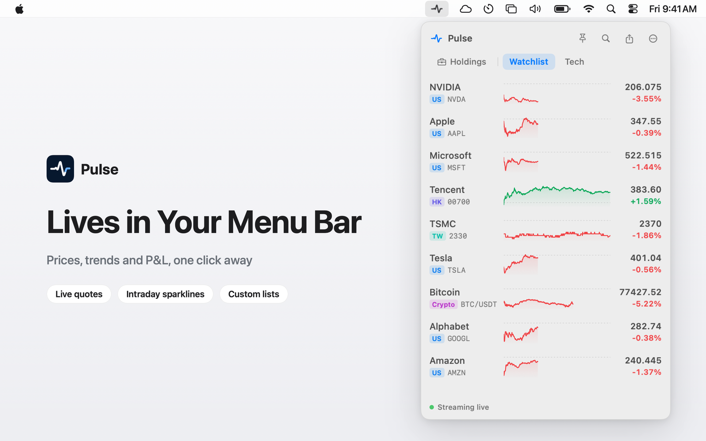

<p>
  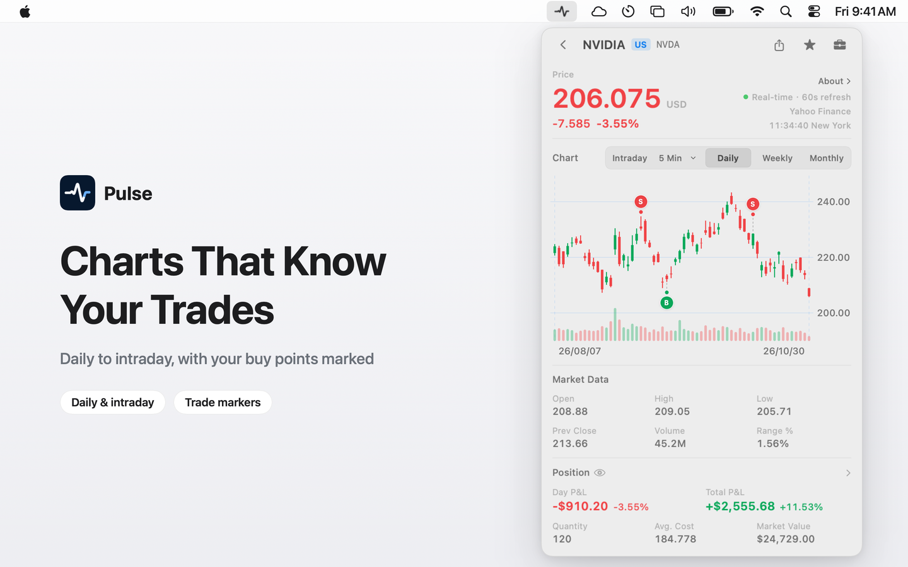
  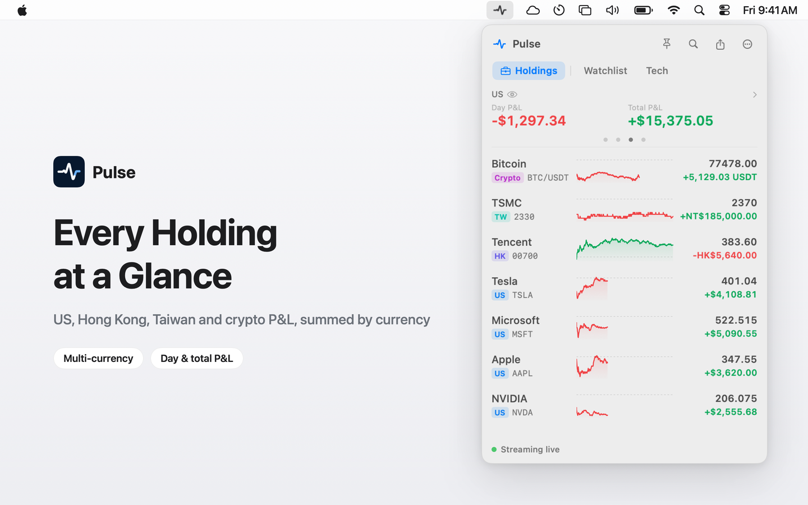
  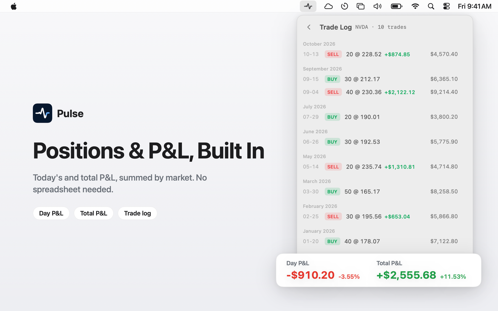
  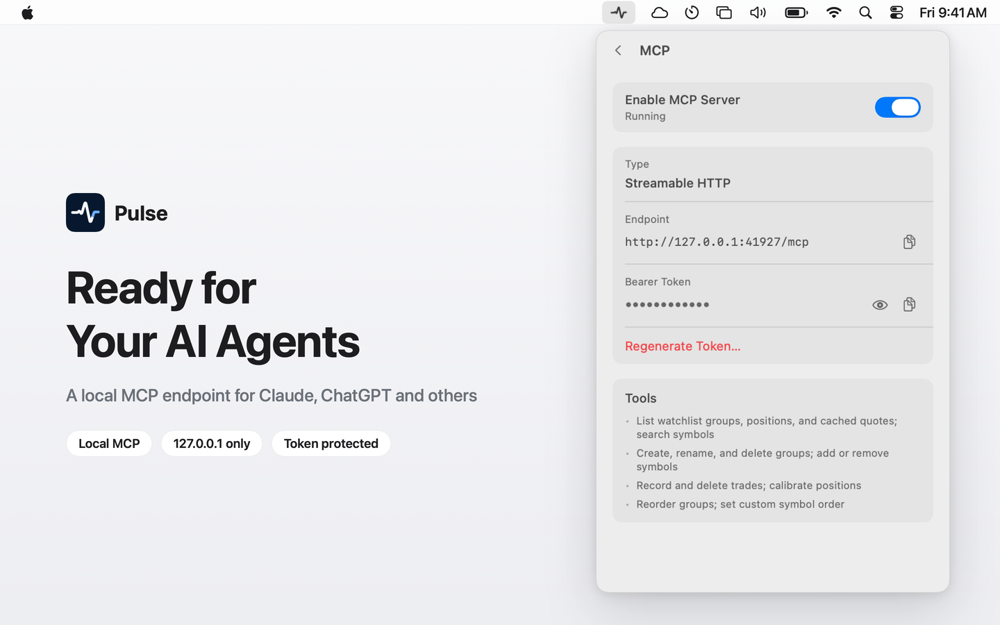
</p>

The current Mac application and website are developed in a private repository.
Their current source is not included here. The historical Mac edition through
**0.15.8** retains its original MIT license in Git history and version tags;
free installers remain available. See [historical Mac source and downloads](docs/history/README.md).

## Pulse for Claude Code

A Claude Code plugin that shows stock and crypto quotes with signed percentage
changes above the prompt, with a `/pulse` panel for adding and removing tickers,
refreshing prices, and pausing updates. Requires Claude Code **2.1.287 or
later**, with Mods enabled.

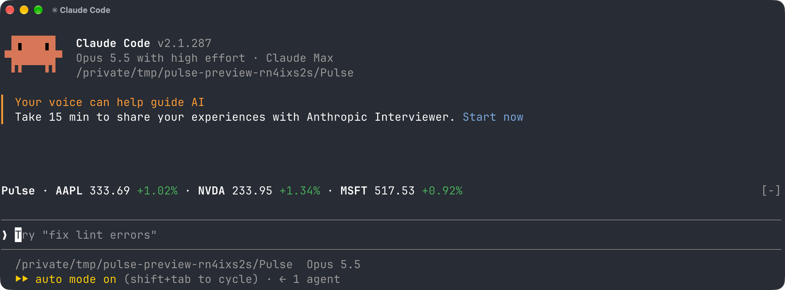

The prices and the `/pulse` panel also work in Claude Desktop's **Code** tab:

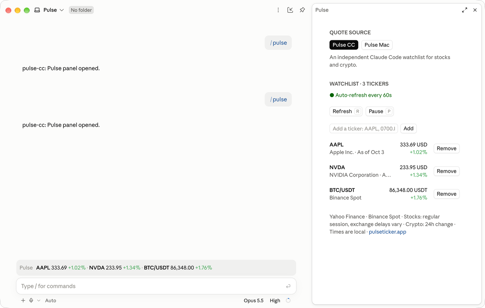

Install from GitHub:

```sh
claude plugin marketplace add fatwang2/Pulse
claude plugin install pulse-cc@pulse
```

Restart Claude Code or run `/reload-plugins`, then add a stock with
`/pulse add AAPL` or a crypto pair with `/pulse add BTC/USDT`, and open `/pulse`
to manage your watchlist.
See the [Claude Code guide](plugins/claude-code/README.md) for commands,
provider limits, privacy, and local development.

## Pulse for opencode

An [opencode](https://opencode.ai) plugin: a stock and crypto watchlist in the
session sidebar, with today's line on every row and a detail view with the
day's open, high, low and previous close, plus a one-line quote band along the
bottom of the window.

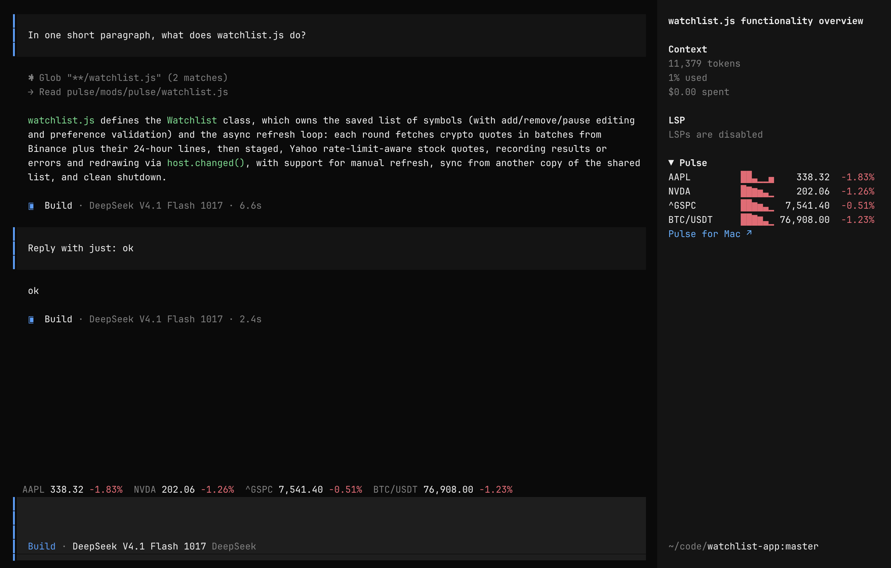

In opencode v2, run `opencode plugin add opencode-pulse-ticker`. In opencode v1
(1.15+), add it to `~/.config/opencode/tui.json` and restart opencode:

```json
{ "plugin": ["opencode-pulse-ticker"] }
```

See the [opencode guide](opencode/README.md) for commands and privacy.

## Pulse for Herdr

A [Herdr](https://herdr.dev) mod: a stock and crypto watchlist docked beside
your agents, with today's line on every row and a detail view with the day's
chart, open, high, low and previous close. Comes as a mod and as a
"Herdr + Pulse" layout.

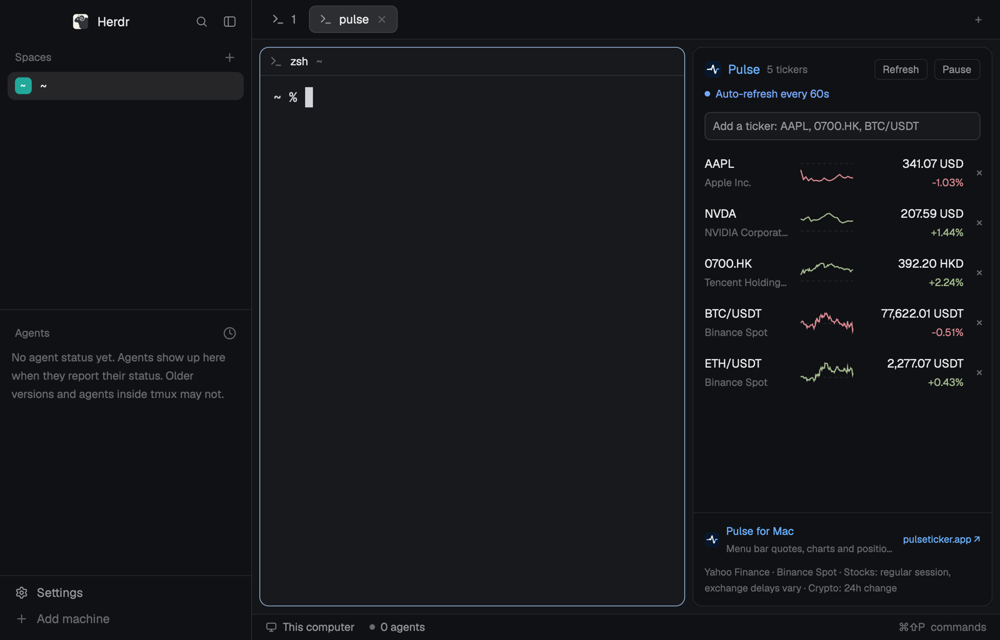

Ask the agent running in Herdr:

```text
Read ~/.config/herdr-app/AGENTS.md, then add this layout: https://github.com/fatwang2/Pulse/tree/main/herdr/pulse-layout
```

See the [Herdr guide](herdr/README.md) for the mod on its own, usage and privacy.

## Pulse for Rex

A [Rex](https://www.superlogical.com/rex) pane: a stock and crypto watchlist
beside your agents, with the selected ticker's day below the list, and a floating layer with its chart, open, high, low and
previous close. Opened from Rex's command palette.

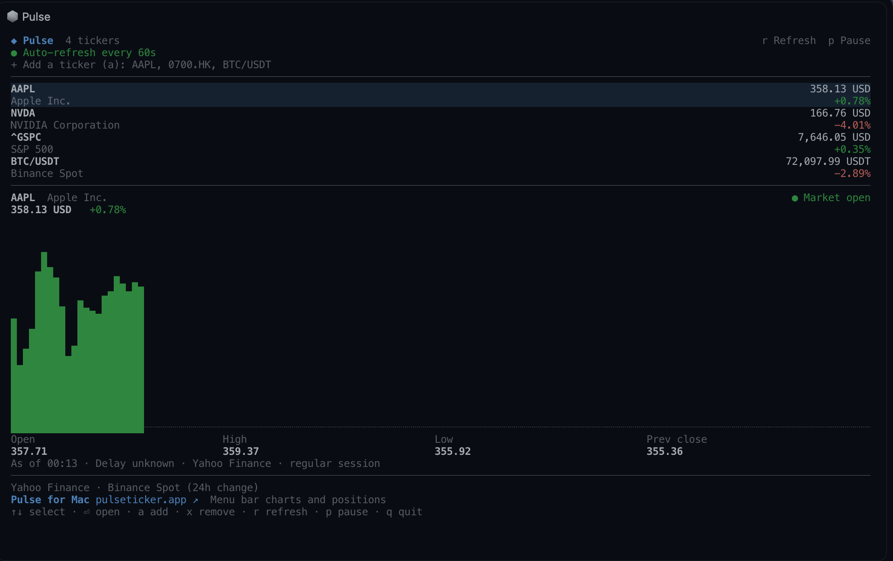

```sh
npm install --global rex-pulse-ticker
pulse-rex install
```

Then press **cmd+shift+p** in Rex and run **Pulse: Open Watchlist**. See the
[Rex guide](rex/README.md) for usage and privacy.

## Pulse for Metrix.Bar

A [Metrix.Bar](https://metrix.bar) dashboard: your first ticker in the menu
bar, and a panel with your watchlist, today's line on every row and a detail
view with the day's chart, open, high, low and previous close. Press **+** to
search by ticker or company name in English, Chinese, Japanese or Korean;
right-click a row to reorder or remove it.

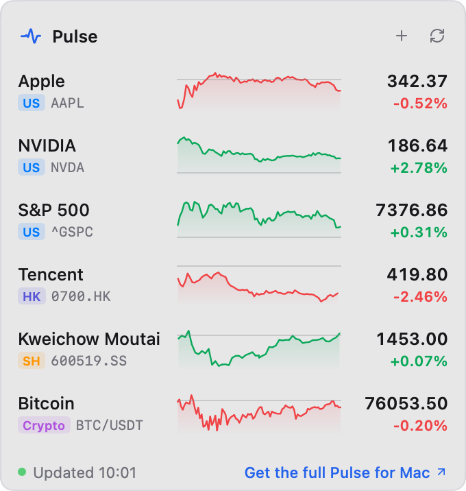

With [Metrix.Bar](https://metrix.bar/download) running, run this in Terminal
(or open the link in a browser), then confirm in Metrix.Bar:

```sh
open "metrixbar://install/pulse?registry_url=https%3A%2F%2Fraw.githubusercontent.com%2Ffatwang2%2FPulse%2Fmain%2Fmetrix%2Findex.json"
```

Installed this way, Metrix.Bar offers new versions as they are published here.
See the [Metrix.Bar guide](metrix/README.md) for usage, settings and privacy.

## Pulse for Omarchy

An independent Pulse edition for Omarchy, with market data in the bar, named
watchlists, symbol search, quote details, charts, and theme-aware presentation.
Requires Omarchy 4 and its Quickshell shell.

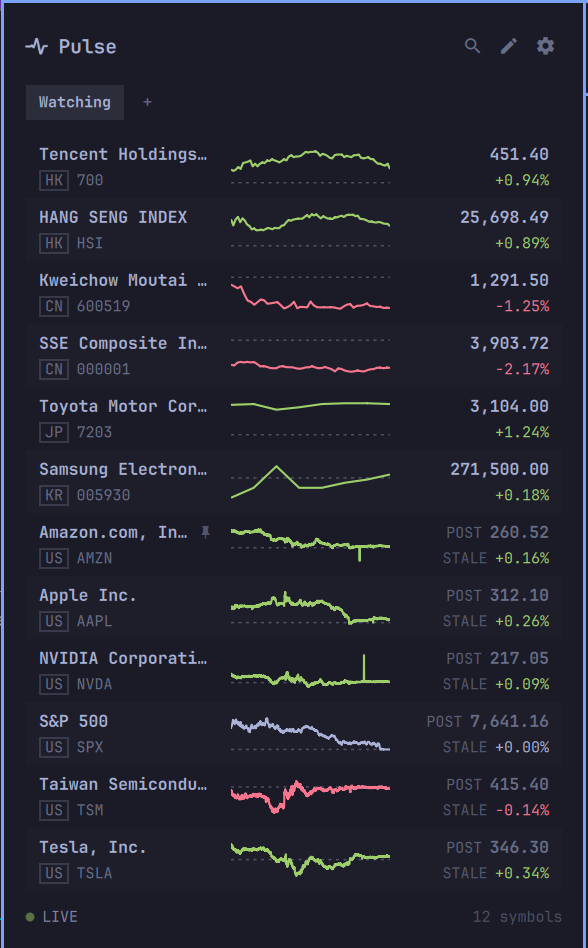

The existing managed installation continues to use the standalone repository
while its installation and update path is migrated:

```sh
omarchy plugin add https://github.com/fatwang2/omarchy-pulse.git --enable
```

The implementation is maintained in [`omarchy/`](omarchy/README.md).
See the [Omarchy guide](omarchy/README.md) for features and local development,
and [repository transition notes](docs/repository-transition.md) for migration details.

## Pulse for Raycast

A [Raycast](https://www.raycast.com) extension with one command, **Search
Symbol**: look up any stock, ETF, index or crypto pair by ticker or by its name
in English, Chinese, Japanese or Korean, and see its price, change and today's
chart. Search runs on your Mac over Pulse's symbol list.

The extension is in review for the Raycast Store
([raycast/extensions#33098](https://github.com/raycast/extensions/pull/33098)).
Until it is listed, run it from this repository with Raycast and Node.js
installed ([development notes](docs/raycast.md)):

```sh
cd raycast
npm install
npm run dev
```

See the [Raycast guide](raycast/README.md) for markets, search and privacy.

## Contributing and feedback

Start with [CONTRIBUTING.md](CONTRIBUTING.md). Each open-source edition has its
own folder, implementation and tests; development does not require building the
Mac app. `make test` runs every edition's checks.
Use [GitHub Issues](https://github.com/fatwang2/Pulse/issues) and identify the edition.
Mac support is also available at [hello@pulseticker.app](mailto:hello@pulseticker.app).
Report security issues privately to [sys@pulseticker.app](mailto:sys@pulseticker.app).

## License

The open-source editions (`plugins/claude-code`, `opencode`, `herdr`, `metrix`,
`omarchy` and `raycast`) are released under the [MIT license](LICENSE), with any
component notices in their folders. That license does not apply to the current
commercial Mac binaries or provide rights to third-party market data. Historical
Mac source retains its original license.
