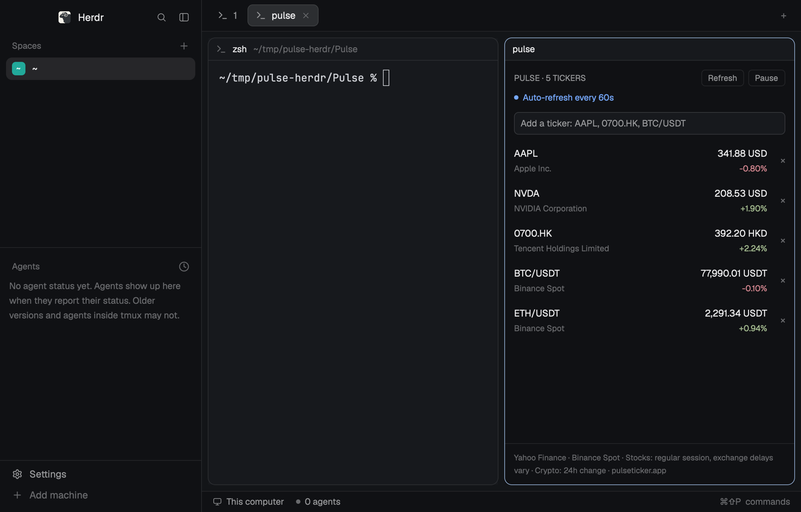

# Pulse for Herdr

A [Herdr](https://herdr.dev) mod from the makers of
[Pulse for Mac](https://www.pulseticker.app/?utm_source=herdr&utm_medium=readme): a stock and crypto
watchlist docked beside your agents. Each ticker shows its price, its change
and today's line; click one for its day: a chart, the open, high, low and
previous close, and whether its market is open. Stocks and indices come from
Yahoo Finance, crypto pairs (`BTC/USDT`) from Binance's public Spot data.
Docked as a short strip, it draws a one-line quote band instead.



Two shareable folders:

- [`pulse/`](pulse/), the mod: `mods/pulse/`, the [`RECIPE.md`](pulse/RECIPE.md)
  another agent can build it from, and `preview.png`.
- [`pulse-layout/`](pulse-layout/), the "Herdr + Pulse" layout: Herdr's
  default window with Pulse as a sidebar on the right
  ([`RECIPE.md`](pulse-layout/RECIPE.md)).

## Install

Ask the agent running in Herdr, for the layout (Pulse is in place when it opens):

```text
Read ~/.config/herdr-app/AGENTS.md, then add this layout: https://github.com/fatwang2/Pulse/tree/main/herdr/pulse-layout
```

or for the mod alone:

```text
Read ~/.config/herdr-app/AGENTS.md, then add this mod: https://github.com/fatwang2/Pulse/tree/main/herdr/pulse
```

By hand: copy `pulse/mods/pulse/` to `~/.config/herdr-app/mods/pulse/` and run
`herdr-app check ~/.config/herdr-app/mods/pulse`. In a layout of your own it
docks on the right the first time Herdr sees it. Herdr's shipped layouts
(`main`, the default) don't take new docks, so open it beside your terminal
there:

```sh
herdr-app do pane.split --direction right --mod pulse
```

For the layout, also copy `pulse-layout/layouts/herdr-pulse.json` and
`herdr-pulse.png` to `~/.config/herdr-app/layouts/` and run
`herdr-app do layout.switch --name herdr-pulse`; `ctrl-shift-l` switches back.

## Use

- It starts with `AAPL`, `NVDA`, `^GSPC` and `BTC/USDT`. Type a ticker in the
  field and press Enter: `AAPL`, `0700.HK`, `^GSPC`, `BTC/USDT`. `×` removes one.
- Click a ticker for its day; Esc closes it.
- **Refresh** runs a round now; **Pause** stops automatic rounds.
- `pulse.refresh` and `pulse.pause` can be bound in `keys.json`.

Quotes refresh 60 seconds after each round. Stock prices are Yahoo's
regular-session quotes; exchange delays vary and are shown when Yahoo reports
them. Crypto changes and lines are 24-hour. A quote from an earlier day
carries its date.

Want quotes in your menu bar, with charts and positions? That's
[Pulse for Mac](https://www.pulseticker.app/?utm_source=herdr&utm_medium=readme).

## Privacy

The watchlist is saved in Herdr's own shared state on your computer. Watching
a ticker sends it to Yahoo Finance; watching a pair sends it to Binance. The
mod contacts no other host, reads no files and has no account or analytics.
The one program it runs is `open`, and only when you click a Pulse link: it
opens `https://www.pulseticker.app/` in your browser, tagged
`utm_source=herdr&utm_medium=mod` and `utm_content=panel` or `detail` for
the link you clicked. See the
[Pulse privacy policy](https://www.pulseticker.app/privacy).

## Development

```sh
node --test herdr/tests/*.test.mjs
```

The tests cover symbol rules, decoding, the session, chart geometry,
formatting, the starter list and the refresh loop with a fake clock, and that
the layout folder's copy of the mod matches `pulse/mods/pulse/`. Rendering
needs Herdr itself: `herdr-app check`.
