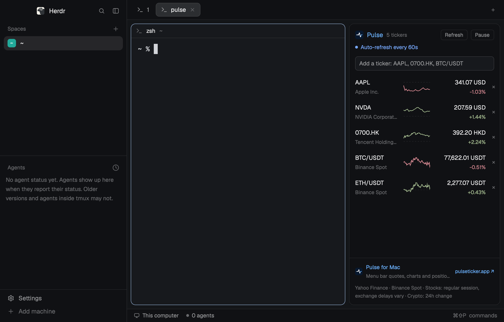

# Herdr + Pulse

Herdr's default window with a stock and crypto watchlist docked on the right, from the makers of [Pulse for Mac](https://www.pulseticker.app/?utm_source=herdr&utm_medium=readme). Spaces and agents on the left, your tab in the middle, and beside it Pulse: prices, changes and today's line for each ticker, a click away from the ticker's day.

## What you see

Left to right, everything as in Herdr's `main` layout ("Herdr"), plus one block:

- **Sidebar**, 268px: the brand bar, Spaces and Agents, and the footer, all Herdr's own `workspace-chrome`, `spaces` and `agents` mods.
- **Work column**: the tab bar (`tabs`), then a row with 8px padding and gaps: the shown tab as cards (radius 10, `border` outline, `accent` while focused, a `pane` header on every pane), Herdr's hidden Files/Changes panel, and **Pulse**: a 320px block (260 to 520px when dragged), radius 10, `border` outline, `chrome` background, drawing the `pulse` mod. Then the status bar (`workspace-status`).
- Pulse is the mod in `mods/pulse/`; its own `RECIPE.md` describes the panel, the band and the detail dialog.

## How it behaves

- Agent status shows as in Herdr's default window (the Spaces and Agents lists, the tab pills, the status bar); Pulse plays no part in it.
- Pulse behaves as its recipe says: starter list, add, remove, click for a ticker's day, Refresh, Pause, a Pulse for Mac link that opens the site.
- Drag the boundary to resize Pulse. Herdr's Files and Changes panel opens beside it from the tab bar.

## Built from

- `layouts/herdr-pulse.json`: a `layout.clone` of `main` (Herdr 0.1.12, `cloned_from` recorded) with one block added at the end of the `work-body` row:
  `{ "id": "pulse", "type": "block", "size": { "px": 320 }, "min": 260, "max": 520, "radius": 10, "border": { "width": 1, "color": "border" }, "background": "chrome", "content": { "mod": "pulse" } }`.
  Root `"preview": "layouts/herdr-pulse.png"` is the picture Settings shows.
- `mods/pulse/`: the Pulse mod, unchanged.
- Shipped mods it uses: `workspace-chrome`, `spaces`, `agents`, `tabs`, `pane`, `files`, `changes`, `workspace-status`.
- Its look is Herdr's: no theme or fonts of its own, so the person's settings decide it.

## Watch out

- Pulse reaches the network (Yahoo Finance and Binance) and runs `open` when a Pulse link is clicked. The rest of the layout is Herdr's own.
- A layout clone is never updated: a later Herdr may change `main`. Rebuild from this recipe on a new version rather than keeping an old clone.
- If a `pulse` mod is already installed, rename this one and the `mod` name in the layout.

## Done when

- `herdr-app check mods/pulse` passes and `layout.switch {name: "herdr-pulse"}` shows the layout with no `herdr-pulse.error`.
- Pulse shows on the right with prices and sparklines within a few seconds.
- `ctrl-shift-l` cycles back to the person's own layout.
