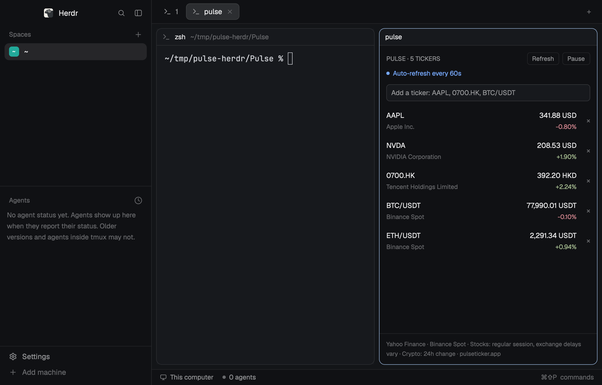

# Pulse

A stock and crypto watchlist docked beside your agents, from the makers of [Pulse for Mac](https://www.pulseticker.app/?utm_source=herdr&utm_medium=readme). Every ticker shows its price, its signed change and today's line; click one for its day: a chart, the open, high, low and previous close, and whether its market is open. Prices refresh every 60 seconds. Dock it as a short strip at the top or bottom and it becomes a one-line quote band.

## What you see

A panel 300 to 320px wide in the theme's `chrome` background with `foreground` text at 12.5px. Pulse's blue is `#6AB0FF` on dark themes and `#1066C6` on light ones (`settings().dark`). Top to bottom:

- **Header**, 12px padding: the Pulse logo (`icon.svg`, 18px, radius 5), `Pulse` (13.5px, semibold, Pulse blue), `5 tickers` (11px, `dim`, truncates), then two small outlined buttons on the right, **Refresh** and **Pause** (22px high, 8px horizontal padding, radius 5, `border` outline, 11px `muted` text; hover fills `hover`). Pause reads **Resume** while paused.
- **Status line** under it: a 6px round dot and 11.5px text in one color. `Auto-refresh every 60s` in `done`, `Refreshing quotes…` in `working` (the dot pulses with a native opacity loop, 0.35 to 1 over 1.2s), `Auto-refresh paused` in `blocked`.
- **Add field**, 10px below: a 30px input, radius 6, `background` fill, `input` border (Pulse blue while focused), placeholder `Add a ticker: AAPL, 0700.HK, BTC/USDT`. Under it, one short line when there is something to say: an error in `ansi1`, the last edit's notice (`Added AAPL.`) in `dim`, or a Yahoo rate-limit note in `blocked`.
- **Watchlist**, the rest of the height, scrolling. One row per ticker in saved order, 12px left padding, 7px vertical, `hover` background on hover:
  - left: the ticker (semibold, truncates) and under it in 11px `dim` the instrument name, `As of Oct 31` when the quote is from an earlier local day, and `Delay 15m` when Yahoo reports a delay, joined with ` · `;
  - a 56×22 sparkline: today's line for a stock (5-minute bars), the last 24 hours for a pair (15-minute bars), 1.25px in the change color, with the previous close as a dashed `border` rule;
  - right-aligned in a 108px column: the price with its currency (`230.10 USD`, `65,000.00 USDT`, `0.00000441`) and under it the signed change (`+1.23%`) in `ansi2` for gains, `ansi1` for losses, `dim` when unknown (`—`);
  - far right: a `dim` `×` that removes the ticker.
  - A failed refresh adds an 11px `blocked` line: `Cached quote · <reason>` when an older price is kept, the reason alone when there is none. Before the first quote, the price reads `Waiting…` (`Not fetched` while paused).
  - Empty: `Your watchlist is empty. Add a ticker above.` in `dim`.
- **Footer**, a `border` line above: a link row with the 16px logo, `Pulse for Mac` (11.5px semibold, Pulse blue), `Menu bar quotes, charts and positions` (10.5px `dim`, truncates) and `pulseticker.app ↗` (Pulse blue); under it in 10.5px `dim` the sources (`Yahoo Finance · Regular-session quotes · Exchange delays vary`, or the crypto variant naming Binance Spot and 24h change when a pair is watched).

**Detail dialog**, 440px wide, opened by clicking a row that has a quote, 18px padding, 14px between parts:

- the ticker (16px semibold) over its name (11.5px `dim`); on the right a 22px outlined pill with a dot and the session: `Market open` (`ansi2`), `Pre-market` or `After hours` (`working`), `Market closed` (`dim`), `Trades 24h` for a pair (`ansi2`); then a `dim` `×` that closes it.
- the price at 26px semibold and the change at 13px in its color.
- a 140px chart across the width: the same line, 2px, over a fill of the change color at 16% opacity, with the dashed previous close.
- four columns, 10.5px `dim` labels over semibold values: Open, High, Low, Prev close (a pair: 24h open, 24h high, 24h low).
- `As of 15:04 · Delay 15m · Yahoo Finance · regular session` in 11px `dim` (a pair: `Binance Spot · 24h`), with the date when it is not today, and `Cached quote · <reason>` in `blocked` after a failed refresh.
- a Pulse for Mac card, radius 8, `raised` fill (`hover` on hover), 12px padding: the 30px logo, `Pulse for Mac` and `Menu bar quotes, charts and positions`, `pulseticker.app ↗`.

**Band**: when the block is under 72px tall (docked top or bottom), the same mod draws one row instead: the 14px logo and `Pulse` in Pulse blue, `Paused` in `blocked` if paused, then each ticker as `AAPL 230.10 +1.23%` (symbol semibold, price without USD or the pair's own quote currency, change colored as above, `cached` in `dim` after a failed refresh), 14px apart, clipped at the right edge. With nothing watched it says `Make the panel taller to add tickers.`

## How it behaves

- Agent status plays no part: the panel looks the same whatever agents are doing.
- **First run**: with nothing saved, the list is `AAPL`, `NVDA`, `^GSPC` and `BTC/USDT`. The first edit saves the person's own list; an emptied list stays empty.
- **Adding**: Enter in the field adds the ticker. Input is upper-cased and checked: Yahoo symbols (`AAPL`, `BRK-B`, `^GSPC`, `7203.T`) or Binance pairs written `BASE/QUOTE`. `700.HK` becomes `0700.HK`; `600519.SH` becomes `600519.SS`. Company names and anything URL-like are refused with an inline error. A duplicate says it is already there. The field clears on success.
- **Removing**: `×` removes the ticker and its cached quote at once.
- **Detail**: a click on a row with a quote opens the dialog with that quote as it was; Esc or `×` closes it. A row without a quote does nothing.
- **Pulse for Mac**: a click on either link opens the Pulse site in the system's browser: `https://www.pulseticker.app/?utm_source=herdr&utm_medium=mod&utm_content=panel` from the panel footer, `https://www.pulseticker.app/?utm_source=herdr&utm_medium=mod&utm_content=detail` from the dialog's card.
- **Copies**: an edit in one copy (add, remove, pause) shows in every other copy at once, and stops that copy's round in flight.
- **Refreshing**: a round starts right after any edit, then 60 seconds after the previous round ends. Pairs go first, up to 100 per Binance request, then one 24-hour line request per pair. Stocks go one at a time to Yahoo, at least one second apart; one request brings the quote and today's line. A pair Binance doesn't know fails only itself: a failed batch is retried pair by pair. A failed line request keeps the last line.
- **Rate limits**: a Yahoo 429 stops the round, marks the remaining stocks `Refresh deferred`, and holds stock requests for at least 60 seconds, doubling on repeats up to 15 minutes. Crypto keeps refreshing through the cooldown. Refresh respects the cooldown for stocks.
- **Pause / Resume**: automatic rounds stop and start; Refresh still runs one round while paused. Cached quotes stay.
- **Commands**: `pulse.refresh` and `pulse.pause` (toggle) reach shown copies through `nextCommand()`; bind them in `keys.json` if wanted. No keys are bound by default.
- Nothing moves except the status dot while refreshing.

## Built from

- **One mod**, `mods/pulse/`, no layout. `mod.json`: `{ "place": "right", "size": 300, "title": "Pulse" }`, so the first time a layout of the person's own shows, it docks on the right. As a pane in any tab: `pane.split {direction: "right", mod: "pulse"}`. The "Herdr + Pulse" layout (`pulse-layout/` in the same repository) puts it beside Herdr's default window.
- `main.js`: the view (`gpui-kit` `div`, `image`, `PathBuilder`, `Background`, `window.paint_path`; `gpui-base` `h_flex`, `v_flex`, `InputState` + `Input`), sized with `on_size_change` to pick panel or band. Colors from `theme()`, plus Pulse blue. The detail dialog is the same mod: `openOverlay({ mod: "pulse", kind: "dialog", width: 440, props: { detail: quote } })`; a copy whose `props()` has `detail` draws only the dialog and starts no loop.
- Charts: `chartGeometry` in `quotes.js` scales a line into `[x%, y%]` points with 8% headroom, the previous close included in the range. `PathBuilder.stroke(...)` for the line, `.dash_array([3, 3])` for the rule, `PathBuilder.fill()` closed along the bottom for the area, each painted with `window.paint_path(...)` as an absolute layer over a sized `div`.
- `watchlist.js`: the list and the refresh loop, with no Herdr imports. Herdr's APIs are passed in as a host: `load`/`save`, `fetch`, `now`, `sleep`, `changed`. The loop runs in one `cx.spawn` for the copy's whole life, sleeping with that task's `cx.sleep` and redrawing with its `cx.notify()`. Edits are synchronous; each bumps a revision so a round in flight drops late results, and wakes the loop. `render` calls `sync()`, which adopts another copy's edit of the shared list the same way (Herdr re-renders every copy on `setShared`).
- `quotes.js`: symbol rules, the URLs, decoding, the session, chart geometry, and number, date and time formatting by hand (no `Intl` in Herdr's runtime).
- `icon.svg`: the Pulse logo, drawn full color with `image("mods/pulse/icon.svg")`.
- **Storage**: `shared("pulse.watchlist.v1")` / `setShared(...)`, persisted by Herdr and seen by every copy: `{ version: 1, symbols: [...], paused }`. The loop re-reads it each round. Quotes and lines are memory only.
- **Network**: `fetch` GETs, with headers `User-Agent: Pulse-Herdr/<version>` and `Accept: application/json`, to two hosts only:
  - `https://query1.finance.yahoo.com/v8/finance/chart/<symbol>?interval=5m&range=1d&includePrePost=false`: `chart.result[0].meta` (`regularMarketPrice`, `regularMarketTime`, `previousClose` else `chartPreviousClose`, `currency`, `longName`/`shortName`, `exchangeDataDelayedBy`, `regularMarketDayHigh`/`Low`, `currentTradingPeriod.pre/regular/post`) and `indicators.quote[0]` (`close` for the line, the first `open`). A response whose `meta.symbol` differs from the request is rejected.
  - `https://data-api.binance.vision/api/v3/ticker/24hr?symbols=["BTCUSDT",...]`: `lastPrice`, `prevClosePrice`, `openPrice`, `highPrice`, `lowPrice`, `closeTime`.
  - `https://data-api.binance.vision/api/v3/klines?symbol=BTCUSDT&interval=15m&limit=96`: closes (index 4) for the 24-hour line.
- **Program**: `exec("open", [url])` with one of the two fixed `PULSE_URLS` in `quotes.js`, only when a Pulse link is clicked.
- Herdr functions: `theme`, `settings`, `shared`, `setShared`, `nextCommand`, `props`, `openOverlay`, `closeOverlay`, `exec` (for `open` only). No `hc`, no files outside the mod.

## Watch out

- The mod reaches the network (Yahoo Finance and Binance, nothing else) and runs one program, `open`, when a Pulse link is clicked.
- Herdr's shipped layouts (`main`) don't take a new mod's `mod.json` dock (Herdr 0.1.12); only a layout of the person's own does. On `main`, open it with `pane.split`, or use the "Herdr + Pulse" layout.
- Without `sync()` on render, a copy kept its old list and paused state until its next round, up to 60 seconds.
- A gradient to a fully transparent `#rrggbb00` stop drew as one flat color; a solid fill with `.opacity(0.16)` reads the same in both themes.
- Keep `×` beside the clickable row content, not inside it, so removing a ticker never also opens its dialog.
- Herdr's `fetch` response has no headers, so Yahoo's `Retry-After` can't be read; the 60-second floor stands in for it.
- Yahoo's chart endpoint is unofficial and may be unavailable in some regions. Prices are regular-session, not pre- or after-hours. Never label cached data as fresh or unknown delay as real time.
- Each shown copy runs its own refresh loop, and timers keep running while a copy is hidden. One copy is the intended setup; a second copy doubles the requests. The dialog copy fetches nothing.
- `toLocaleString` options are ignored in Herdr's QuickJS: format prices with grouping and 2 decimals (2 to 4 significant digits below 1), and times as `HH:MM`, by hand.
- Keep the change colors on `ansi2`/`ansi1`; a theme's own `done` color isn't necessarily green.

## Done when

- `herdr-app check mods/pulse` passes.
- `node --test` on the Pulse repository's `herdr/tests` passes (symbol rules, decoding, the session, chart geometry, formatting, the starter list, the refresh loop with a fake clock).
- A fresh install shows `AAPL`, `NVDA`, `^GSPC` and `BTC/USDT` with prices and sparklines within a few seconds.
- Adding `0700.HK` adds a row; `Apple` shows an error and adds nothing.
- Clicking `AAPL` opens its day with a chart, Open/High/Low/Prev close and the session; Esc closes it.
- Clicking `pulseticker.app ↗` opens the Pulse site.
- `×` removes a row immediately; Pause stops automatic requests and Refresh still runs one round.
- Resizing the block below 72px shows the one-line band; taller shows the panel again.
- Pausing in one copy shows `Auto-refresh paused` in every copy at once.
- Restarting Herdr keeps the watchlist and paused state.
