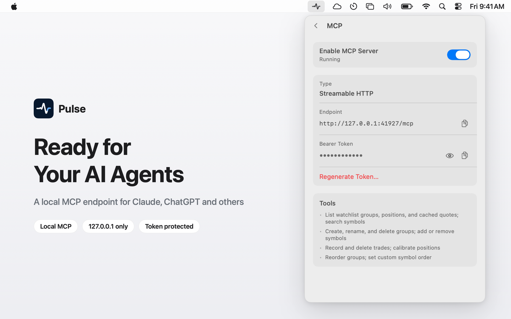

# Pulse MCP

[](https://mcpservers.org/servers/github-com-fatwang2-pulse-tree-main-mcp)

**A local MCP server for stock and crypto quotes, watchlists and positions, built into
[Pulse for Mac](https://www.pulseticker.app/mcp?utm_source=github&utm_medium=mcp-readme).**

Turn it on in Pulse and Claude Code, Claude Desktop, Cursor, Codex, VS Code or
any other MCP client on your Mac gets live quotes for your watchlist, symbol
search across markets, and tools to edit your watchlists and record trades.
It runs at `127.0.0.1` and answers only to your token.



> Pulse MCP is part of the closed-source Pulse for Mac app. It isn't a separate
> package or a hosted service, and this folder holds documentation only.
> Every feature, MCP included, is free for 30 days; then Pulse is a one-time
> purchase. See [pricing and downloads](https://www.pulseticker.app/buy?utm_source=github&utm_medium=mcp-readme).

| | |
| --- | --- |
| Transport | Streamable HTTP |
| Endpoint | `http://127.0.0.1:41927/mcp` |
| Auth | `Authorization: Bearer <token>`, token kept in the macOS Keychain |
| Requires | Pulse for Mac on macOS 14+, running, with the MCP server switched on |
| Markets | US, Hong Kong, China, Taiwan, Japan and Korea stocks, ETFs and indices; crypto; precious metals |

## Tools

15 tools. Read tools carry the MCP read-only hint, so your client can run them
without asking and ask before any change.

### Quotes and search

| Tool | | What it does |
| --- | --- | --- |
| `get_quotes` | read only | The latest quotes Pulse has cached for the symbols you name: price, previous close, change %, currency, quote time and market state. |
| `search_symbols` | read only | Find a stock, ETF, index, crypto pair or metal by name or ticker, across markets. |

### Watchlists

| Tool | | What it does |
| --- | --- | --- |
| `list_watchlists` | read only | Every watchlist group with its id, name and symbols. |
| `create_group` | changes data | Create a group. Names are unique and up to 20 characters. |
| `rename_group` | changes data | Rename a group. |
| `delete_group` | changes data | Delete a group. Trades and open positions are kept; the last group stays. |
| `add_symbol` | changes data | Add a symbol to a group, using the market and code from `search_symbols`. |
| `remove_symbol` | changes data | Remove a symbol from a group. |
| `reorder_groups` | changes data | Set the left-to-right order of the group tabs. |
| `reorder_symbols` | changes data | Set a group's custom order. Pinned symbols stay on top. |

### Positions and trades

| Tool | | What it does |
| --- | --- | --- |
| `list_positions` | read only | Holdings, average cost, realized P&L, transactions and the cached quote for every symbol with trades, closed ones included. |
| `record_trade` | changes data | Record a buy or sell. Pass an id and a retry won't record it twice. |
| `update_trade` | changes data | Change the side, quantity, price or date of a recorded trade. |
| `delete_trade` | changes data | Delete a recorded trade. The position and P&L are recalculated. |
| `calibrate_position` | changes data | Set a position to an exact quantity and average cost, for example to match your broker. |

`get_quotes` answers from what Pulse is already refreshing for your watchlist.
For a symbol you don't follow yet, the agent adds it with `add_symbol` and
quotes it on the next refresh.

Things to ask:

- "What are NVDA, Tesla and Tencent trading at right now? Is the US market open?"
- "Find Toyota and Samsung, add them to my Asia group, and tell me how they're doing today."
- "How are my positions doing today? Which one lost the most?"
- "Here's a screenshot of my broker's trade history. Record these trades in Pulse."

## Set up

1. [Download Pulse for Mac](https://www.pulseticker.app/buy?utm_source=github&utm_medium=mcp-readme)
   or get it from the [Mac App Store](https://apps.apple.com/app/id6812160110).
2. Click Pulse in the menu bar, open **Settings**, and choose **MCP** under **Agents**.
3. Switch on **Enable MCP Server**. The status reads Running and the endpoint
   appears.
4. Copy the Bearer token and paste it into your client's config below in place
   of `YOUR_PULSE_TOKEN`. Then ask the client to list your watchlists to check.

The token is a password for your watchlists and positions. Don't commit it to a
shared repository.

### Claude Code

```sh
claude mcp add --transport http pulse http://127.0.0.1:41927/mcp \
  --header "Authorization: Bearer YOUR_PULSE_TOKEN"
```

Add `--scope user` to use Pulse in every project.

### Claude Desktop

Settings → Developer → Edit Config. Claude Desktop reads local servers through
the `mcp-remote` bridge, which needs Node.js.

```json
{
  "mcpServers": {
    "pulse": {
      "command": "npx",
      "args": ["-y", "mcp-remote", "http://127.0.0.1:41927/mcp", "--allow-http", "--header", "Authorization:${PULSE_AUTH}"],
      "env": { "PULSE_AUTH": "Bearer YOUR_PULSE_TOKEN" }
    }
  }
}
```

### Cursor

`~/.cursor/mcp.json` for every project, or `.cursor/mcp.json` in one project:

```json
{
  "mcpServers": {
    "pulse": {
      "url": "http://127.0.0.1:41927/mcp",
      "headers": { "Authorization": "Bearer YOUR_PULSE_TOKEN" }
    }
  }
}
```

### Codex

`~/.codex/config.toml`, then start Codex:

```toml
[mcp_servers.pulse]
url = "http://127.0.0.1:41927/mcp"
http_headers = { Authorization = "Bearer YOUR_PULSE_TOKEN" }
```

### VS Code

`.vscode/mcp.json` in your workspace, or your user `mcp.json`. Use with
Copilot agent mode.

```json
{
  "servers": {
    "pulse": {
      "type": "http",
      "url": "http://127.0.0.1:41927/mcp",
      "headers": { "Authorization": "Bearer YOUR_PULSE_TOKEN" }
    }
  }
}
```

### Other clients

Any client on the same Mac that speaks Streamable HTTP and can send a header:

```text
URL:    http://127.0.0.1:41927/mcp
Header: Authorization: Bearer YOUR_PULSE_TOKEN
```

ChatGPT and claude.ai connectors in the browser can't use Pulse MCP: they run
on OpenAI's and Anthropic's servers, which can't reach a server bound to
`127.0.0.1` on your Mac.

## Security

- **Localhost only.** Pulse listens on `127.0.0.1:41927`. Other devices on your
  network, and the internet, can't reach it.
- **Token in the Keychain.** A random 256-bit token is created on first use and
  kept in the macOS Keychain. Every request without it is refused. Regenerate it
  anytime and every connected client is cut off.
- **Web pages are blocked.** Requests from a browser page on another origin are
  rejected.
- **Off by default.** Nothing listens until you turn the server on, and it stops
  when you turn it off or quit Pulse.
- **No trading.** The tools edit Pulse's own watchlists and trade records. Pulse
  never places orders and has no access to your broker account.
- **Your data, your client.** Pulse doesn't upload your watchlists or positions.
  What a tool returns goes to the AI client you connected, and from there to
  that client's model provider under its own terms.

## Troubleshooting

If a client can't connect, check that Pulse is running and **Settings → Agents
→ MCP** reads Running, that the URL is `http://127.0.0.1:41927/mcp`, and that
the header is `Authorization: Bearer` followed by the current token. A
regenerated token makes old configs fail with 401. When the trial ends, the
server stops until you buy Pulse; your watchlists, trades and token stay on your
Mac.

## More

- [Pulse MCP on pulseticker.app](https://www.pulseticker.app/mcp?utm_source=github&utm_medium=mcp-readme),
  also in 简体中文, 繁體中文, 日本語 and 한국어
- Support: [hello@pulseticker.app](mailto:hello@pulseticker.app) ·
  [GitHub Issues](https://github.com/fatwang2/Pulse/issues)
