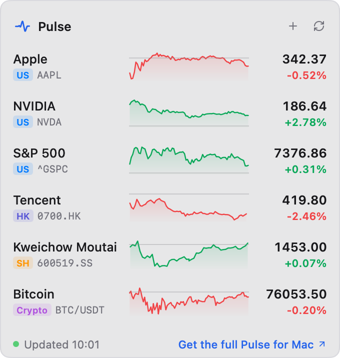

# Pulse for Metrix.Bar

A [Metrix.Bar](https://metrix.bar) dashboard from the makers of
[Pulse for Mac](https://www.pulseticker.app/?utm_source=metrixbar&utm_medium=readme):
a stock and crypto watchlist in your menu bar. Each ticker shows its price,
its change and today's line; click one for its day: a chart, the open, high,
low and previous close, and whether its market is open. Stocks and indices
come from Yahoo Finance, crypto pairs (`BTC/USDT`) from Binance's public Spot
data.



## Install

Install [Metrix.Bar](https://metrix.bar/download) and open it once. Then run
this in Terminal, or open the link in your browser:

```sh
open "metrixbar://install/pulse?registry_url=https%3A%2F%2Fraw.githubusercontent.com%2Ffatwang2%2FPulse%2Fmain%2Fmetrix%2Findex.json"
```

Metrix.Bar shows the hosts the dashboard contacts and its settings, and
installs it after you confirm. The link also adds this folder's
[`index.json`](index.json) as a dashboard source, so Metrix.Bar offers new
versions as they are published here.

An agent connected to Metrix.Bar's local API (its
[Agent Skill](https://metrix.bar/docs/agents)) can install
[`pulse.bar`](pulse.bar) for you instead. That copy is a local import and is
not offered updates.

Metrix.Bar's free plan holds a limited number of dashboards. If you are at the
limit, Pulse installs disabled until you remove one or upgrade.

## Use

- It starts with `AAPL`, `NVDA`, `^GSPC`, `0700.HK` and `BTC/USDT`. The first
  ticker is shown in the menu bar, or choose **Pulse icon only** in the
  dashboard's settings.
- **+** (or ⌘F) opens search: type a ticker or a company name in English,
  Chinese, Japanese or Korean (`AAPL`, `Tencent`, `腾讯`, `600519`, `7203`,
  `BTC`) and click **+**, or press Return for the top result. A full ticker
  the search doesn't know (`GC=F`, `ETH/BTC`) can be added as typed. With the
  field empty it lists your watchlist to reorder or remove.
- Right-click a row to move it to the top, up or down, or remove it.
- Click a ticker for its day; Esc goes back. ⌘R refreshes.
- Settings: **Starting watchlist** (editing it replaces the panel's list),
  **Menu bar** and **Up / down colors** (green up or red up).

Quotes refresh every minute. Stock prices are Yahoo's regular-session quotes;
exchange delays vary and are shown when Yahoo reports them. Crypto changes and
lines are 24-hour. A quote from an earlier day carries its date. The interface
is in English or Chinese, following your system language; names follow it
too where the catalog has them.

Positions and P&L, US pre-market and after-hours charts, candlesticks from
5 minutes to monthly, a rotating menu bar ticker and named watchlists are in
[Pulse for Mac](https://www.pulseticker.app/?utm_source=metrixbar&utm_medium=readme),
free to try for 30 days.

## Privacy

The watchlist is saved in Metrix.Bar's storage for this dashboard on your
computer. Watching a ticker sends it to Yahoo Finance
(`query1.finance.yahoo.com`); watching a pair sends it to Binance
(`data-api.binance.vision`). Search runs on your computer over Pulse's symbol
catalog, downloaded from `www.pulseticker.app` when you first search (and at
start-up on a Chinese, Japanese or Korean system, for names) and at most once
a day after that; what you type is not sent anywhere. The dashboard contacts
no other host, reads no files and has no account or analytics. It opens
`https://www.pulseticker.app/` in your browser only when you click a Pulse
link, tagged `utm_source=metrixbar&utm_medium=dashboard` and `utm_content`
`footer`, `detail` or `menu`. See the
[Pulse privacy policy](https://www.pulseticker.app/privacy).

## Development

```sh
node --test metrix/tests/*.test.mjs
```

The tests check that `index.json` matches `pulse.bar` (its SHA-256 and
version), the declared hosts, and the Worker's symbol rules, search ranking
and price formatting. Rendering and live quotes need Metrix.Bar: validate and
preview a change with its local API (`POST /v0/validate` and
`POST /v0/check`), then rebuild the index:

```sh
curl -fsS https://metrix.bar/dashboards/build.js -o /tmp/build.js
mkdir -p /tmp/pulse-in && cp metrix/pulse.bar /tmp/pulse-in/
node /tmp/build.js --input /tmp/pulse-in --output /tmp/pulse-out --id pulse --name "Pulse"
cp /tmp/pulse-out/index.json metrix/index.json
```
