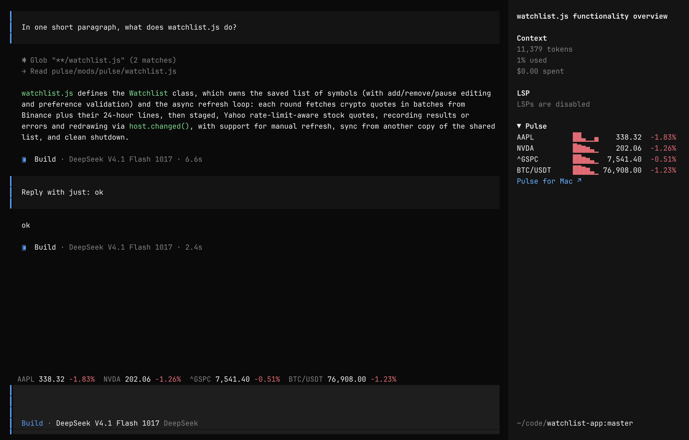

# Pulse for opencode

An [opencode](https://opencode.ai) plugin from the makers of
[Pulse for Mac](https://www.pulseticker.app/?utm_source=opencode&utm_medium=readme): a stock and
crypto watchlist in the session sidebar, and a one-line quote band along the
bottom of the window. Each ticker in the sidebar shows its price, today's line and its change; click one for its day: the open, high, low and previous
close, and whether its market is open. Stocks and indices come from Yahoo
Finance, crypto pairs (`BTC/USDT`) from Binance's public Spot data.



## Install

Works with both opencode lines: v1 (`opencode-ai` 1.15 or later) and v2
(`@opencode/cli` 2.x).

**opencode v2:** run `opencode plugin add opencode-pulse-ticker`, or add it to
`~/.config/opencode/cli.json` yourself:

```json
{
  "plugins": ["opencode-pulse-ticker"]
}
```

**opencode v1:** add the plugin to `tui.json`
(`~/.config/opencode/tui.json` for every project, or `.opencode/tui.json` in one):

```json
{
  "$schema": "https://opencode.ai/tui.json",
  "plugin": ["opencode-pulse-ticker"]
}
```

Restart opencode and open a session: Pulse appears in the sidebar. To start
from your own list instead of the starter one (AAPL, NVDA, ^GSPC, BTC/USDT),
pass it as an option. In v2's `cli.json`:

```json
{
  "plugins": [{ "package": "opencode-pulse-ticker", "options": { "symbols": ["AAPL", "0700.HK", "^GSPC", "BTC/USDT"], "placement": "bottom" } }]
}
```

In v1's `tui.json`:

```json
{
  "plugin": [["opencode-pulse-ticker", { "symbols": ["AAPL", "0700.HK", "^GSPC", "BTC/USDT"], "placement": "bottom" }]]
}
```

`placement` sets where the quote band goes; `/pulse-band` changes it later:

| `placement` | Where |
| --- | --- |
| `bottom` (default) | The bottom line of the window, on every screen |
| `right` | In the prompt's footer, on the right (v1: right of the model name), first two tickers |
| `off` | No band; the sidebar only |

## Use

| Command | What it does |
| --- | --- |
| `/pulse-add` | Add a ticker: `AAPL`, `0700.HK`, `600519.SS`, `^GSPC`, `BTC-USD` (Yahoo) or a Binance Spot pair such as `BTC/USDT` |
| `/pulse-remove` | Pick a ticker to remove |
| `/pulse-refresh` | Refresh now |
| `/pulse-pause` | Pause or resume automatic refresh |
| `/pulse-band` | Move the quote band, or turn it off |

The same commands are in the command palette (`ctrl+p`) under Pulse. Click a
row for its detail, and the "Pulse" heading to fold the panel.

Quotes refresh every minute. Stock requests are spaced a second apart, and
when Yahoo rate limits them, Pulse waits (one minute, doubling up to fifteen)
before it asks again; crypto pairs keep refreshing meanwhile. A quote from an
earlier day carries its date, and a delay Yahoo does not state is shown as
"delay unknown", never as real time.

## Privacy

Pulse sends read-only requests to two hosts, `query1.finance.yahoo.com` and
`data-api.binance.vision`, with the tickers on your list and nothing else. Your
watchlist stays in opencode's own storage on your computer. The only program the
plugin starts is your system's browser (`open`, `xdg-open` or `start`), and
only when you click "Pulse for Mac".

Market data belongs to its providers and is for information only, not
investment advice.

## Pulse for Mac

Want the same watchlist in your menu bar, with charts and positions?
[Pulse for Mac](https://www.pulseticker.app/?utm_source=opencode&utm_medium=readme)

## Development

In opencode v2, link your checkout into a project's `.opencode/plugins/`
(`ln -s /path/to/Pulse/opencode .opencode/plugins/pulse`); v2 reloads it on
save. In v1, point `tui.json` at it and restart opencode after each change:

```json
{ "plugin": ["/path/to/Pulse/opencode"] }
```

`node --test opencode/tests/*.test.mjs` from the repository root runs the tests.
To release, bump the version in `package.json` and `src/view.tsx`, merge, and
push the tag `opencode-v<version>`: GitHub Actions publishes to npm with
provenance (trusted publishing, no token) and creates a GitHub release.
`src/quotes.js` and `src/watchlist.js` are shared with the Herdr mod; see
[AGENTS.md](AGENTS.md).

MIT licensed. See [LICENSE](LICENSE).
